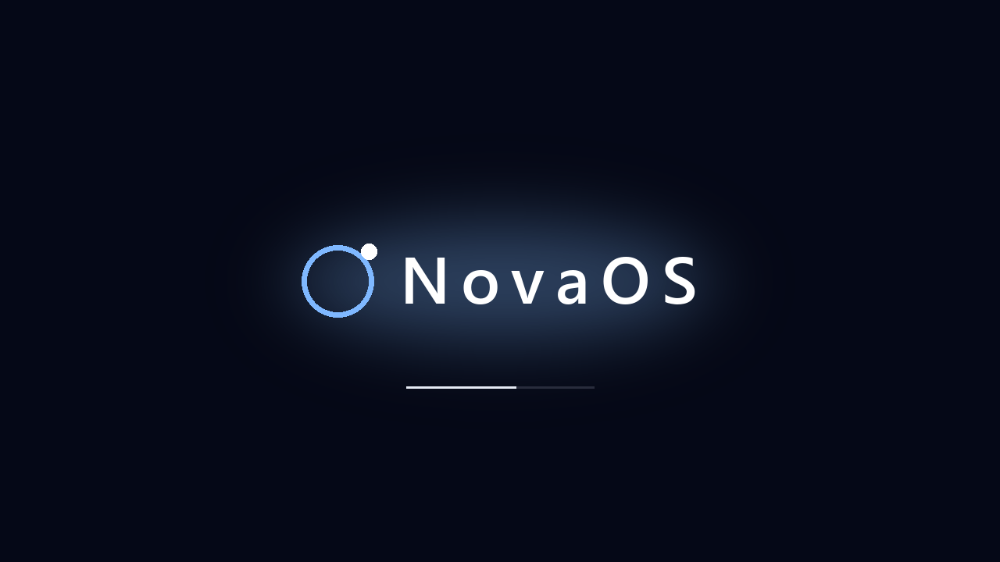

# NovaOS

Een eigen console-achtig gaming-OS, gebouwd op [Bazzite](https://bazzite.gg) met [BlueBuild](https://blue-build.org).
Start op met een eigen opstartscherm en gaat dan meteen naar een controller-interface (Game Mode).



## Wat zit waar

| Bestand | Wat het doet |
|---|---|
| `recipes/recipe.yml` | Basis van je OS (Bazzite, Intel/AMD-graphics) → image `novaos` |
| `recipes/common.yml` | **Hier pas je je OS aan**: extra programma's, scripts |
| `files/system/` | Wordt 1-op-1 in het OS gekopieerd (opstartthema zit hier) |
| `files/scripts/branding.sh` | Zet je naam in het opstartmenu en activeert het opstartscherm |
| `tools/make_logo.py` | Maakt het logo opnieuw (andere naam/kleur) |
| `.github/workflows/build.yml` | Laat GitHub je OS elke dag automatisch bouwen |

---

## Stap 1 — Project op GitHub zetten

1. Maak een (gratis) account op github.com.
2. Maak een nieuwe **public** repository, bijvoorbeeld `novaos`.
3. Upload deze hele map (makkelijkst met **GitHub Desktop**: *Add existing repository* → *Publish*).

## Stap 2 — Ondertekeningssleutel maken (eenmalig)

Hiermee kan je laptop controleren dat updates echt van jou komen.

In PowerShell, in deze map:

```powershell
winget install sigstore.cosign
```

```powershell
$env:COSIGN_PASSWORD=""; cosign generate-key-pair
```

Je krijgt twee bestanden:
- `cosign.pub` → **wel** uploaden naar GitHub (hoort in de repo).
- `cosign.key` → **nooit** uploaden (staat al in `.gitignore`). Open hem in Kladblok, kopieer alles, en zet het op GitHub bij
  *Settings → Secrets and variables → Actions → New repository secret*, naam: `SIGNING_SECRET`.

Bewaar `cosign.key` ergens veilig.

## Stap 3 — Eerste build

- Push/upload `cosign.pub`. Op GitHub, tab **Actions**, zie je de build starten (±20–40 min).
- Als hij groen is: ga naar je profiel → **Packages** → `novaos` → *Package settings* → *Change visibility* → **Public**.

## Stap 4 — Installeren naast Windows

**Eerst in Windows:**
1. Backup van belangrijke bestanden.
2. BitLocker-herstelsleutel opzoeken: account.microsoft.com/devices/recoverykey
3. Snel opstarten uit: *Configuratiescherm → Energiebeheer → Wat de aan/uit-knoppen doen*.
4. *Schijfbeheer* → rechtsklik C: → **Volume verkleinen** (minstens 150 GB vrij).

**Dan:**
1. Download de Bazzite-ISO via bazzite.gg: kies **Intel/AMD**-graphics en de **Steam Gaming Mode**-variant (deck).
2. Zet hem op een USB-stick met Fedora Media Writer of Rufus.
3. Opstarten vanaf USB (F12/F2/Esc bij het opstarten), installeren op de **vrije ruimte**, *niet* "hele schijf wissen".
   Secure Boot mag aan blijven; volg de stap om de sleutel in te schrijven (wachtwoord: `universalblue`).

## Stap 5 — Overstappen naar NovaOS

In Bazzite: *Game Mode → Power → Switch to Desktop*, open **Konsole** en typ (vervang `JOUWNAAM` door je GitHub-naam):

```bash
rpm-ostree rebase ostree-unverified-registry:ghcr.io/JOUWNAAM/novaos:latest
systemctl reboot
```

Na de herstart (je ziet nu het NovaOS-opstartscherm), nog één keer om updates ondertekend te maken:

```bash
rpm-ostree rebase ostree-image-signed:docker://ghcr.io/JOUWNAAM/novaos:latest
systemctl reboot
```

Klaar. Vanaf nu haalt je laptop automatisch jouw nieuwste versie binnen.

Iets stuk na een update? Kies in het opstartmenu de vorige versie, of typ `rpm-ostree rollback`.

---

## Games

- **Steam**: werkt direct in Game Mode.
- **Epic / GOG / Amazon**: installeer *Heroic Games Launcher* via de app-store in Desktop Mode.
- **Losse games (.exe)**: in Desktop Mode via Steam → *Een niet-Steam-game toevoegen* (zet Proton aan bij Compatibiliteit), dan staan ze ook in Game Mode.
- ❌ Game Pass/Xbox-app en games met kernel-anticheat (Valorant, Fortnite, CoD) → die speel je in Windows.

## Aanpassen

- **Programma toevoegen**: zet de naam onder `packages:` in `recipes/common.yml` en push. Na de volgende build heeft je laptop hem.
- **Andere naam of kleur**:
  ```powershell
  python tools/make_logo.py "MijnNaam" "#ff5a7a"
  ```
  en verander `OS_NAME` in `files/scripts/branding.sh`.
- **Eigen logo**: vervang `files/system/usr/share/plymouth/themes/novaos/logo.png` (transparante PNG, max ~600 px breed).
